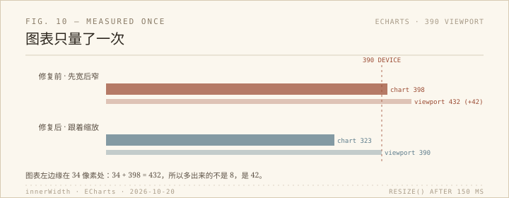

上次扫全站，扫的是宽度：19 个页面在 390 下有没有横向溢出。这次换了个方向，写脚本把 18 个页面的链接、图片、重复 id、标题层级都读一遍。链接一条没坏，重复 id 那一栏跳出来一个 `more-book-7`。

## 按下去不动的按钮

`sharing/sharing.html` 里，《鼠疫》的「一些读后感」按钮点下去没有任何反应。不是没内容——它有内容，只是 `onclick="showMoreText('book-7')"`，内容 div 的 id 也写成 `more-book-7`，和《挪威的森林》撞了。`getElementById` 只返回第一个，所以点《鼠疫》展开的是《挪威的森林》那篇读后感，而那一篇在隐藏的面板里。用户看到的是按钮按下去、页面不动。

这个 bug 用眼睛很难发现：按钮在，内容在，控制台也不报错。重复 id 在 HTML 里不算致命错误，浏览器不会提醒，只有把 `[id]` 全部数一遍才会露出来。修法也简单：《鼠疫》这一篇还没写，梗概是空的，读后感也是空的，与其留一个打开空盒子的按钮，不如把按钮和空 div 删掉，换成站点里其他未写篇目一样的「这一篇还在心里，尚未落笔。」。顺手把这一页十二处 ` ` 改成 ` `，还有一处多出来的 `</s>`。浏览器一直替这些错误兜底，所以它们能活很久。

## 432 是量出来的

修完标题，我按惯例在 390 下量宽度。`tools/picture_analysis/picture_analysis.html` 报 `innerWidth = 432`。

432 不是随口来的。把超出视口的元素列出来，只有一个：`#chartContainer` 里面那个 ECharts 生成的 div，写死 `width: 398px`。图表的左边缘在 34 像素处，34 + 398 = 432。CSS 里 `#chartContainer { width: 100% !important }` 管的是外层容器，管不到 ECharts 自己插进来的那个 div。

原因是 ECharts 只在 `echarts.init()` 的时候量一次容器。页面在 1264 的窗口里打开，图表就按 398 宽画；把窗口缩到 390，它不重新量，还是 398。于是 390 的屏上有一块 398 宽的东西，浏览器为了放下它，把布局视口撑到 432，再把整页缩小给你看——字变小，但看起来「没坏」。手机横竖屏切换是同一条路径：竖屏打开、横过去、再竖回来，图表还记着横屏的宽度。

修法是加一个 150 毫秒防抖的 resize 监听，调 `myChart.resize()`。测了三次：390 打开，图表 323；转到 844，716；转回 390，323，`innerWidth`、`clientWidth`、`scrollWidth` 都是 390。这里有个测试上的坑：CDP 改设备尺寸不会触发 `resize` 事件，得手动 `dispatchEvent`，不然会以为修失败了。

## 看不见的标题

第三件事很小：这一页本来没有 h1，只有一行 `<h3>图片浏览</h3>`，两个 `<label>` 也没和输入框绑定。我补了一个只给读屏软件的 h1，把 h3 换成 h2，`label` 加上 `for`。字号、颜色、下边框都没变，因为 CSS 选择器跟着改了。读屏软件拿到的顺序从「h3 图片浏览」变成「h1 图片色彩分析 → h2 图片浏览」，两个 label 也能点了。这些改动在截图里完全看不出来。

三处改完，1440 和 390 下页面都干净，明暗两色看过了（图表页本来就是暗色单主题，只换 `data-theme` 不会变色，这是它的设计），控制台零报错。没有 commit，没有 push。

## 题外

写完回头看，这天量到的东西有一个共同点：它们都不是「坏得很明显」的那种。一个按钮点了没反应，一个图表在窗口变小后不肯跟着变，一个页面没有一级标题。三样都不影响页面打开，也不进控制台。它们只影响某一种用法：用键盘、用读屏、把手机横过来、把窗口拖窄。

上次写「全站不是页面集合，是每种用法下的页面集合」，这次又验证了一遍。量一次不够，得在每种用法下各量一次。
