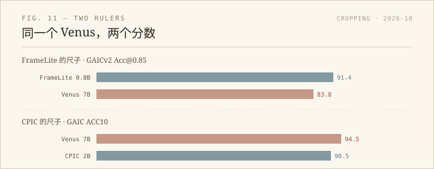

我一直在给照片页找「自动构图」的参考，这周刷到两篇图像裁剪（aesthetic image cropping）的论文，发表时间只差十三天。点开作者列表，两篇几乎同一组人：上海交大 + 华为，通讯作者都是 Yulun Zhang。一篇叫 CPIC，九月三十日；一篇叫 FrameLite，十月十三日。正文里互不引用。

## 同一道题

两篇问的是同一件事：给一张原图，裁出构图最好的那一块。输入是一个框 `(x1, y1, x2, y2)`，输出也是一个框。

它们也都盯上了同一组数据集的毛病。CPIC 把问题说得很直：主流裁剪数据集只有 6 到 19 个标注者，而且候选框被锁在 12×12 的网格上。前者让「好构图」变成了几个人的口味，后者让模型只会输出网格点。它数了一个很刺眼的数：在 200 张 GAIC 测试图上，Venus 在 800 个预测位置里只吐出 43 个不同的坐标值——很多不相干的照片，模型给出的是同一个框。

FrameLite 的切入点更工程：既然手机要的是立刻给一个建议，为什么非得用 7B 的模型？它用 Qwen3.5-0.8B，先教模型定位主体、学构图偏好，再让它从自己生成的候选里挑最好的答案来模仿（QOS），最后按「比当前贪心答案好多少」做带符号的修正（GRO）。推理时只输出一个框，不搜索、不重排。

两篇的动机我都认。一个在修数据，一个在修部署。

## CPIC：把离散的标注摊成连续的地形

CPIC 的做法是把人类偏好建模成一片「多峰、连续、锐利」的场：一张图可以有好几个都成立的构图（多峰）；好框往旁边挪几像素还是好框（连续）；但一旦切到主体的脸，分数要断崖式下跌（锐利）。

它从离散标注里把这三点恢复出来：先把高分候选按 IoU 聚成几个峰，再在网格外做局部扰动，挑出更精确的峰；然后人为构造五类「负样本」——切主体、破坏构图、丢掉环境、模板框、原标注里的低分框——给它们低分，制造悬崖；最后把峰和负样本拼成一个连续的打分函数。这个场既当 GRPO 的奖励，也用来重标测试集的 ground truth（CPICD）。

数字上它很诚实，也很不客气：GAIC 的 ACC10 是 90.5，低于 Venus 的 94.5；FLMS 的 IoU 是 84.2，也低于 Venus 的 85.6。但同一个 GAIC，换成 SRCC（排序相关性）它又翻了过来：0.590 对 0.541。它赢在 FCDB（71.4 对 68.3）和用户研究（46.3% 对 32.5%），以及自己重标后的 CPICD（78.9 对 76.3）。CPICD 和原 ground truth 二选一，人选 CPICD 的比例是 64.5% 对 35.5%。

## FrameLite：小模型的第一答案

FrameLite 的起点是一个观察：一个只受过基础训练的小模型，第一个答案不够好，但让它采样 16 次再挑最好的，分数会从 90.4 跳到 99.4（GAICv2）；FLMS 从 84.1 到 93.0，FCDB 从 67.8 到 81.6。差距就是训练空间。

所以它不改变推理成本，只改变训练目标：QOS 让模型模仿「当前策略生成的最好答案」，GRO 再用每个样本相对贪心答案的质量差做加权。最终 0.8B 的模型在 GAICv2 Acc@0.85 上是 91.4，Venus 是 83.8；FLMS IoU 86.79 对 86.38；FCDB 71.24 对 68.36。

它没有解释，也不打算解释。给摄影师一个框，就结束。

## 尺子

把两篇的表放在一起，最值得看的不是谁高，而是同一篇 Venus 在两篇里有两个分数：FrameLite 的表里是 83.8，CPIC 的表里是 94.5。

不是谁抄错了。前者量的是 GAICv2 的 Acc@0.85——预测框和五张高分参考里任意一张的 IoU 超过 0.85 就算对；后者量的是 GAIC 的 ACC10——另一套判定。两个指标都叫「准确率」，但一个宽松一个严格，数字不能直接比。同样，FrameLite 没报 ACC10，CPIC 没报 Acc@0.85。

能放在同一把尺子上的只有 FLMS 和 FCDB：FLMS 上 FrameLite 略高（86.79 对 84.2），FCDB 上 CPIC 略高（71.4 对 71.24）——0.16 个百分点，基本是噪声。所以更准确的说法是：两篇都赢了 Venus 的 FCDB，FrameLite 赢了 FLMS，CPIC 的胜利主要在用户偏好和它自己重标的测试集上。

这不是说 CPIC 在自说自话。它的人类研究是独立的：20 个人、1200 次选择、方法名全部隐藏。但「用自己的场重标 ground truth，再用人的偏好证明重标更好」这个闭环，仍然需要别人来复核。

## 我会用哪篇

如果只是想要一个能塞进网页的重量级建议，FrameLite 更实际：0.8B、单框输出、不依赖云端。它的代码承诺在 GitHub 发布，我没有验证仓库是否已经能跑，所以这里只记论文。

如果想理解「什么叫构图上的一步之差」，CPIC 的那张地形图更有用。它把「IoU 0.86 但切掉了帆」和「IoU 0.80 但完整」分开，说明几何重叠量不出美感。这一点对做照片工具的人比多一个 SOTA 更重要。

两篇都没有回答我最想问的问题：为什么这个框好。它们给坐标，不给理由。也许下一步该看的不是裁剪模型，而是能说出「左边留白太多」的那种模型。

- CPIC: https://arxiv.org/abs/2610.00582
- FrameLite: https://arxiv.org/abs/2610.17639
