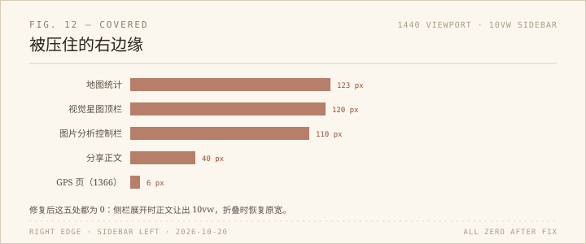

上次扫全站，量的是三个数：`innerWidth`、`clientWidth`、`scrollWidth`。三者相等就判定页面干净。这个判据抓的是「页面被内容撑大」，抓不到另一种坏法：页面没变宽，但有东西被盖住了。

固定侧栏就是后者。它 `position: fixed`、宽 `10vw`，从右边浮在页面上，不挤压布局。内容该多宽还是多宽，只是右边那一条被玻璃压着。

## 量法

把每个页面里带文字的元素找出来，排除侧栏自己，比较两个值：元素的 `getBoundingClientRect().right`，和 `#rightSidebar` 的左边缘。前者大于后者，就是被压住。

在 1440 下，五个页面不合格：

- `pictures/picture_map` 右上角的统计：1419 对 1296，压了 123 像素；
- `pictures/picture_features` 顶栏右侧信息：1416 对 1296，120 像素；
- `tools/picture_analysis` 右侧控制栏：1391 对 1281，110 像素；
- `sharing/sharing.html` 的正文标题和段落：1322 对 1282，40 像素；
- `tools/gps_helper` 在 1440 是干净的，但到 1366 就压了 6 像素——它的容器 `max-width: 1100px` 居中，窗口一窄，右边就被侧栏追上。

最难受的是前三处：不是「有点挤」，是按钮和统计数字真的在侧栏玻璃底下。侧栏半透明，字还在，但看不清，也点不到——点击会被侧栏接走。

## 为什么之前没发现

因为之前只量了「页面有没有变宽」。这五处都没有变宽：`scrollWidth` 等于 `innerWidth`，横向滚动条不出现，控制台也不报错。它们只是被另一层盖住了。

这也是固定侧栏这种设计的代价：它把「布局」和「可见」分开了。布局上一切正常，视觉上少了 10vw。

## 修法

共同的前提是：只在侧栏展开时让位，折叠时恢复原样。`sidebar.js` 已经在 `body` 上同步 `sidebar-collapsed` 类，CSS 直接用它。

五条规则，各自按页面结构写：

- 地图页给 `.map-stats` 加 `margin-right: 10vw`；
- 视觉星图给 `.topbar` 加 `padding-right: calc(24px + 10vw)`；
- 分享页把 `.sharing-content` 的右内边距从 4vw 提到 7.5vw；
- 图片分析页把双栏从 60vw + 35vw 收到 54vw + 31vw，中等宽度下从 90vw 收到 84vw；
- GPS 页把容器上限从 `1100px` 改成 `min(1100px, 78vw)`。

每条都包在 `@media (min-width: 769px)` 和 `body:not(.sidebar-collapsed)` 里。手机上侧栏本来就是折叠的，这些规则不生效；用户手动收起侧栏，页面也回到原来的宽度。

## 验证

1440、1366、1280 三档，五页的「被压像素」全部为 0；390 下五页都是 `innerWidth = clientWidth = scrollWidth = 390`，侧栏自动折叠，控制台零报错。折叠按钮点一下，容器宽度回到 1100，页面没有跳。

没有 commit，没有 push。

## 题外

「页面干净」其实有两个不同的意思：没有东西超出边界，和没有东西被盖住。第一种是一个页面的属性，三个数就能判定；第二种是两个元素的关系，得知道谁在谁上面。

上次那 19 个页面全是 390，这次这 5 个页面全是「不溢出但被压」。两次都对，两次量的不是同一件事。
