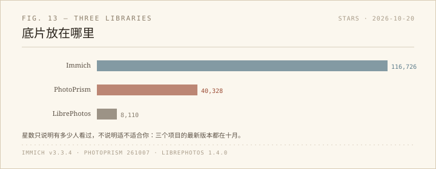

网站上的「映像」是我挑出来的结果，底片不在那里。原图散在手机、移动硬盘和几个年份的文件夹里，找一张旧照片要先想「那是哪一年」。这周干脆看了三个自托管相册，想把底片收进一个能搜索、能按人脸和地点翻的地方。

## Immich：最大，也最像「产品」

116,726 星，7,286 个 fork，最新版本 v3.3.4 就发在今天（2026-10-20），AGPL-3.0，TypeScript。README 的能力表很完整：手机端后台自动备份、按相册选择性备份、人脸识别与聚类、按物体/人脸/CLIP 搜索、RAW、Live Photo、多用户、公开分享。它已经不是「相册脚本」，而是一套要长期维护的服务。

适合谁：手机里照片最多、最想要「打开 App 就自动备份」的人。代价是它需要一台一直开着的机器，以及你愿意跟着它的版本节奏走——今天还在发 3.3.4，说明这个项目跑得很快。

## PhotoPrism：Docker 一条龙，WebDAV 是亮点

40,328 星，2,333 个 fork，最新版本是 `261007-65faaae5d`（2026-10-07），Go 写的。README 说得很直接：只要有浏览器和 Docker，Mac、Linux、Windows 都能跑；树莓派和 Apple Silicon 用同一个镜像。

它的功能偏「浏览与整理」：自动打标签、识别家人朋友的脸、按颜色/画质/地点筛选、六张世界地图、PWA 可以装到手机桌面。对我最有吸引力的是 WebDAV——Windows 资源管理器可以直接挂载，把相册当成一个网络盘来打开、编辑、删除。

一个需要留意的点：GitHub API 返回的 license 字段是 `NOASSERTION`，README 上挂的徽章写的是 AGPL 3.0。自己用问题不大，真要分发或商用，先读 LICENSE。

## LibrePhotos：最小，但对这台 Windows 最友好

8,110 星，413 个 fork，最新版本 1.4.0（2026-10-17），MIT，Python/Django + React + Expo。它刚把五个仓库合并成一个 monorepo，安装方式列了五种：单容器、Docker Compose、Kubernetes、Unraid，以及 **Windows standalone**——一个文件夹，里面有 `librephotos.exe`，不需要 Docker 也不需要 Python。

系统要求写得清楚：最低 4 GB 内存、2 核 CPU，推荐 8 GB 以上；人脸识别、场景分类、图像描述这些 ML 功能吃内存。功能上没有 Immich 那么全，但 RAW、HEIC、JPEG XL、Live Photo、人脸聚类、语义搜索、多用户、公开链接都有。

适合谁：不想为了一个相册先学 Docker 的人，或者想先在一台旧笔记本上试水的人。MIT 也是三个里最宽松的。

## 三个共同的坑

第一，别把它跑在唯一的副本上。Immich 的 README 开头就放了 3-2-1 备份的警告；相册软件会移动、重命名、写缩略图，任何一步出错都可能伤到原图。

第二，人脸、相册、标签这些「整理成果」大多存在应用自己的数据库里，不在照片的 EXIF 里。用久了会形成锁定：换软件不是换一个文件夹，而是迁移一整套人和相册的关系。选之前先想清楚导出路径。

第三，它们都是「服务」，不是桌面软件。要远程访问就得有 HTTPS、端口、备份和更新；放在家里旧电脑上，还要接受它偶尔宕机。

## 我会先试哪个

如果明天就动手，我会先在旧笔记本上解压 LibrePhotos 的 Windows 版，指向一份**复制出来的**照片目录，看它索引一夜要多久、内存吃多少。这一步不通，另外两个也不用谈。

如果最后发现真正想要的是手机自动备份，那就回到 Immich——它的手机端能力是三个里最完整的，代价是接受一套需要维护的服务。PhotoPrism 则在中间：Docker 部署不难，WebDAV 和 PWA 很实用，适合把它当成「家里的照片浏览器」，而不是手机备份中心。

这三个我都没有实际安装，只读了仓库、README 和 release；星数与版本是 2026-10-20 查看的。等真正跑起来，再补一篇踩坑记录。

- Immich: https://github.com/immich-app/immich
- PhotoPrism: https://github.com/photoprism/photoprism
- LibrePhotos: https://github.com/LibrePhotos/librephotos
