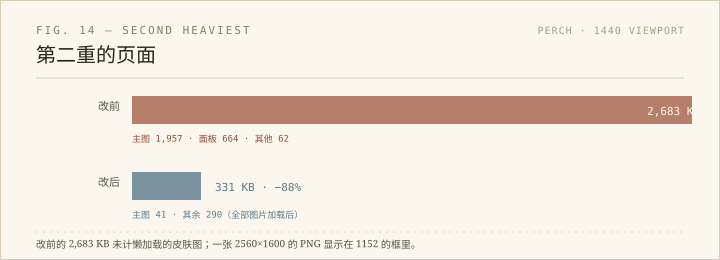

把轻笺那九张截图转成 WebP 之后，我以为图片的事告一段落了。这轮把 18 个页面的传输量都量了一遍，才发现「最重的那个」修完，第二个才会露出来。

## 量出来的排名

关掉缓存，逐页加载，读 `performance.getEntriesByType('resource')` 的 `transferSize`：

- `projects/perch` 2,683 KB；
- `health/health_data` 2,037 KB（echarts 1,010 + echarts-gl 625 + d3 144）；
- `pictures/picture_map` 1,494 KB（echarts 760 + china.geojson 569）；
- 三个图表页各 930 KB 左右，几乎全是 echarts；
- 首页 433 KB。

Perch 的 2.7 MB 里，一张 `hero-desktop.png` 就占 1,957 KB：2560×1600，显示在 1152 像素的框里。另外三张 1600×1000 的面板图各 189–248 KB，显示宽度 802。和轻笺一样的问题，只是换了一个页面。

## 转了什么

`cwebp -q 82`，主图出 1200 和 1600 两档，面板出 800 和 1200 两档，一共十一个文件（主图多一个 800，后来没用上，实际用了十个）。所有 WebP 加起来 364 KB，最大的 1600 主图 57 KB，最小的面板 15 KB。

HTML 只加两个属性：`srcset` 和 `sizes`。原来的 PNG 继续留在 `src` 里做回退，没有 `<picture>`，没有改 CSS。主图的 `sizes` 是 `(max-width: 768px) 90vw, 1152px`，面板是 `90vw, 802px`，皮肤面板是 `660px`。

## 数字

1440 宽、桌面 DPR 1：首屏图片传输 168 KB，整页 190 KB；把懒加载的皮肤图和气泡图都算上，图片 308 KB，整页 331 KB。主图实际选的是 1200 档。390 宽、DPR 2：全部图片 386 KB，整页 409 KB，主图仍是 1200 档（因为主图最小档就是 1200），面板落到 800 档。

主图的显示框还是 1152×720，比例 1.6，跟改之前一样；`currentSrc` 全部以 `.webp` 结尾，`complete && naturalWidth > 0`；390 下没有横向溢出，控制台零报错。

懒加载的皮肤面板和气泡图在无头浏览器里不会因为 `scrollIntoView` 就加载，我把 `loading` 临时改成 `eager` 才确认它们能解码——这是测试环境的毛病，不是页面的。真实滚动时它们照常加载。

## 还没动的

健康页 2 MB、地图页 1.5 MB，重的是 echarts，不是图片。这两个要动就得改脚本加载方式：要么按需加载，要么换成更小的构建。它们不像图片那样「换个格式就行」，得先确认图表在首屏是否真的需要。这轮没有碰。

Perch 的 PNG 原图都还在，回滚只需要删掉五行 `srcset`。没有 commit，没有 push。

## 题外

优化不是一个动作，是一个列表。修掉第一名，第二名才会出现；如果不重新量，就会以为「图片已经优化过了」。

这次也确认了一件事：同一套方法可以用在第二个页面上，但前提是先量。轻笺是 6.9 MB，Perch 是 2.7 MB，数字不同，病因一样——原图的像素比显示框多一个数量级。
