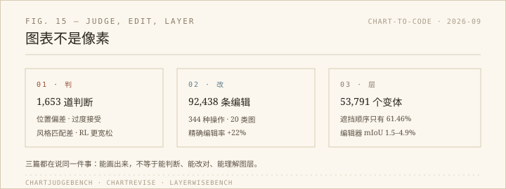

站里的图表生成器走的是「文字 → 代码 → 图」。我最近想给它加一个「改这张图」的入口：把标题改短、把颜色换成另一套、把图例挪到下面。看完三篇九月的论文，发现这件事比生成难得多。

## 判：模型当裁判可靠吗

ChartJudgeBench 做了 1,653 道判断：1,003 道是两张图二选一，650 道是对「图表复现」和「图表编辑」的结果做接受/拒绝。它模拟的正是现在很流行的一套流程——让一个大模型看着图打勾，再把它的判断当成强化学习的奖励。

结果有四种系统性偏差：二选一时偏爱某个位置；倾向于过度接受；分不清视觉风格；以及一个反直觉的发现——经过 RL 训练的模型反而更宽松。论文的结论很克制：把这些模型当 critic 或 reward 之前，得先单独验它的可靠性。

这对我很直接。如果我用「模型说像」来当改图成功的标准，那标准本身没被验证过。

## 改：一次编辑要改几处代码

ChartRevise 把「编辑」拆得很细：92,438 条记录，344 种编辑操作，20 类图表，3 个绘图库。它的评价协议不只看代码能不能跑、图好不好看，而是分开量三件事：要求完成了没有、有没有顺手改坏别的、该联动更新的地方有没有漏。

比如把标题改短，坐标轴标签可能得让位，图例可能要换行；只改标题不管后面两处，图就坏了。论文说，在这套协议下微调，平均要求召回率提升 16%，精确编辑率提升 22%。

## 层：遮挡顺序是最难的一关

LayerWiseBench 的角度更底层：图表不是一团像素，而是一叠有名字、有绑定、有前后顺序的图层。它从可执行的图表程序生成 2,800 张图，配了每层的 RGBA 和构造标签，派生出 7,329 道理解题和 53,791 个编辑变体。

数字很整齐：Qwen3.5-27B 在「这层是什么」上 93.04%，在「这层对应哪个数据」上 97.46%，但到了「谁盖住谁」只剩 61.46%。四个图像编辑器的整体 mIoU 只有 1.49% 到 4.93%，涉及遮挡关系的编辑更低，0.37% 到 2.00%。

也就是说，模型知道那是标题、那是图例，但不太知道标题压在了图例上面。

## 我的顺序

三篇放在一起，其实是同一条流水线的三个检查点：判、改、层。如果我要做那个「改图」入口，顺序应该是：

1. 先让代码跑通、图能渲染出来；
2. 再比对结构——要求清单、被改动的代码、该联动的地方；
3. 最后才让模型看「好不好看」。

把模型放在第一步当唯一裁判，是这三篇论文都在提醒的错误。

## 说明

三篇都是 2026 年 9 月的预印本，发表不到六周；我读的是摘要、任务设定和头条结果，没有复现实验。三组数字各自在自己的基准上成立，不能横向比较——61.46% 和「提升 22%」不是同一种量。

- ChartJudgeBench: https://arxiv.org/abs/2609.24210
- ChartRevise: https://arxiv.org/abs/2609.38642
- LayerWiseBench: https://arxiv.org/abs/2609.08657
