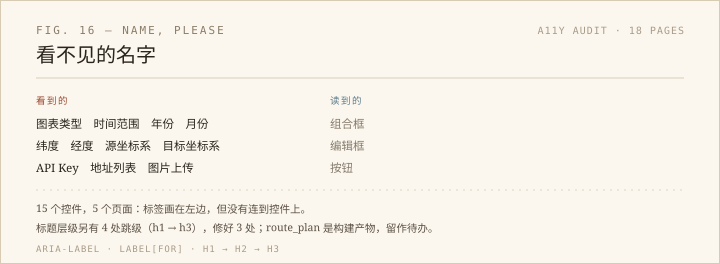

我写了一个小脚本，在 18 个页面里找两类东西：没有名字的表单控件，和跳级的标题。前者找到 15 个，后者找到 4 处。

## 标签不等于名字

健康页有四个下拉框：图表类型、时间范围、年份、月份。每个左边都有一行 `<label>图表类型</label>`，看起来没问题。

但那个 label 没有 `for`，下拉框也没有 `aria-label`。按可访问名称的计算顺序，`label` 必须通过 `for` 指向控件的 `id`（或者把控件包在里面）才算数。现在这层关系断了，读屏软件走到下拉框前，只会念「组合框」，然后停住。它不知道这是图表类型，还是时间范围。

同样的断法还有 GPS 页：纬度、经度、源坐标系、目标坐标系、批量坐标输入、地名搜索、高德 Key、地址列表，八个。图表快速页的数据框、AI 页的输入框、图片分析的上传按钮，各一个。总共 15 个，5 个页面。

## 最典型的是坐标转换

GPS 页有一行是「WGS84 → GCJ02」，两个下拉框中间夹一个箭头。视觉上一眼就懂：左边是源，右边是目标。

但单独看第二个下拉框，它只有三个选项：GCJ02、BD09、WGS84。没有名字，就没有「目标是哪个坐标系」这层意思。键盘用户 Tab 过去，听到的是「组合框，GCJ02」，再 Tab，又是「组合框，GCJ02」——两个一模一样的东西。

修法很轻：健康页的四个 label 补 `for`，其余控件加 `aria-label`。没有改布局，没有加可见文字。改完再跑一遍审计，15 个归零。

## 标题的台阶

另一类问题是标题层级。健康页从 h1 直接跳到 h3，GPS 页和场景图例页也是。原因不难猜：h3 的字号、字重刚好合适，就直接用了 h3，没人规定它必须跟在 h2 后面。

但标题级别不是字号，是文档大纲。读屏软件的用户常常按 H 键在各个标题之间跳，h1 → h3 等于告诉他们「中间有一层被跳过了」，而实际并不存在那一层。

我把这三页的 h3 改成 h2，同步改了两条 CSS 选择器。量了改后的计算字号：健康页 15.2px 和 16.8px，GPS 13.6px，图例 16px，和改之前一致。视觉上什么也没发生，大纲上少了一个坑。

## 还剩一个

`tools/route_plan/dist/` 是 Vite 的构建产物，渲染出来也是 h1 → h3。源码在 `src/`，但要改得重新构建；这次没有动，记在这里。构建产物里的可访问性问题，改源码才算真修。

## 一点感受

这类问题有个共同点：眼睛完全看不出来。CSS 把 label 摆在控件左边，把 h3 调成合适的字号，页面「看起来是对的」。只有去问 DOM「这个控件的名字是什么」，才会发现连接断了。

修起来一共十几行，找起来却需要换一种看法：不看页面长什么样，看它被读成什么样。
