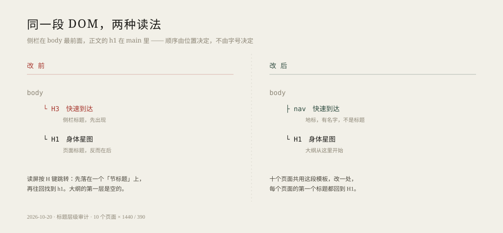

上一轮报告的最后一句留了个尾巴：`tools/route_plan/dist/` 里的标题从 h1 跳到 h3，源码要重新构建，没动。这轮本来只想把它补掉。

打开构建产物，用脚本列出标题：先是 `H1 配置高德地图 Key`，然后 `H3 快速到达`。第二项不是页面的，是右侧那条固定侧栏的。

## h3 站在 h1 前面

侧栏是 `sidebar.js` 生成的模板，第一行就是 `<h3 class="sidebar-title">快速到达</h3>`。它挂在 `<body>` 下的 `#sidebar-container` 里，而页面的 `<h1>` 在 `main` 里面。DOM 顺序上，h3 比 h1 早。

读屏用户按 H 键逐个跳标题时，先听到「快速到达，三级标题」，再听到「身体星图，一级标题」。层级不是读出来的顺序，是位置加标签名。上一轮我只扫源码里的 h3，数出四处跳级；真正让路线规划器那页跳级的，是这段被十个页面共用的模板。

## 侧栏不是一节内容

把 `
` 换成 `<nav class="right-sidebar" aria-label="快速到达">`，标题那行换成 `
`。class 一个没动：`siderbar.css` 全按 class 写，折叠按钮和子菜单脚本也都按 class 找元素。

量了改后的计算样式：首页标题 18px、字重 600、margin-top 0；健康页 15px、600；路线规划器 15px、700、margin-top 15px（那页没有全局 reset，p 的 1em 正好等于原 h3 的 1em）。与改前一致。

十个加载共享侧栏的页面，加上运行时注入同一份 `sidebar.js` 的路线规划器，都不再有这个 h3。无障碍树里，它现在是名字为「快速到达」的 `navigation`。

## 拾遗集：十六个 h1

顺手看其它页面，发现 `sharing.html` 每个书、影面板的标题都是 `<h1>`，一共十六个。同时只显示一个，屏幕上看不出问题；但 DOM 里左侧「分类目录」的 h2 排在它前面，大纲还是 h2 → h1。

给页面加了一个 `sr-only` 的 h1「拾遗集 · 书影分享」，面板标题降为 h2，改了三处 CSS 选择器。桌面上标题仍是 45.9px、900 字重，手机上 25.5px；`margin-top` 被全局 reset 成 0，版面没有移动。

## 路线规划器

主界面原本没有 h1，只有时间轴和冲突面板两个 h3。补了一个 sr-only 的 h1「扫街摄影路线规划器」，两个面板改成 h2。用 `react-dom/server` 临时渲染了这两个组件，确认输出里是 `<h2>`、没有 `<h3>`；临时测试文件随后删掉。

`npm test` 的 42 个用例全过，`npm run build` 重建了 `dist/`：JS 211.61 kB、CSS 17.02 kB。

## 验证

十个页面在 1440 和 390 各跑一遍：第一个标题都是 H1，横向溢出 0，控制台 0 错误。侧栏折叠按钮仍然工作，点击后 `aria-expanded` 从 true 变 false，面板从 x=1292 移到 1416。

## 一点想法

上一轮我在页面里找问题，找到四处；这一轮发现其中一处根本不是页面的事。共用模板里的一个标签，会同时在十个页面上成立——修的时候也一样。先问「这段 HTML 是谁生成的」，再问「它写对了吗」，大概比直接改页面省力。
