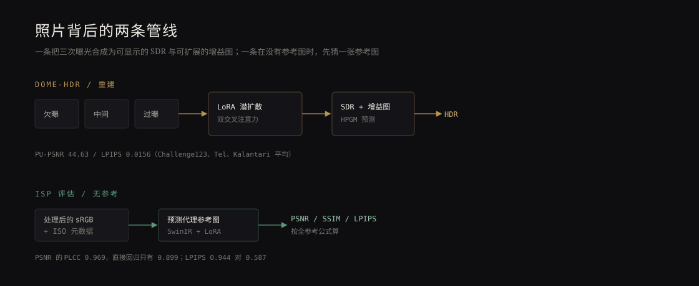

拍逆光的天空时，手机屏幕上会亮一下，右上角出现一个小小的 HDR 标记。我一直知道那不是「一次曝光」，但直到读这两篇论文，才把中间那层算法想清楚：传感器记录的是线性亮度，最后看到的照片是降噪、去马赛克、色调映射、压缩之后的结果；HDR 也不是把亮部「拉回来」，而是在一张 SDR 图上叠一张增益图。

## 三张曝光，两个输出

第一篇是延世大学的 DOME-HDR（[arXiv:2608.05626](https://arxiv.org/abs/2608.05626)，2026-08-06）。输入是三张不同快门的 LDR：欠曝、中间、过曝。做法分两步。

第一步，用 LoRA 微调的潜扩散模型（基于 UltraFusion）合成一张基础 SDR。中间曝光作锚点，欠曝和过曝各走一条交叉注意力分支：欠曝补高光结构，过曝补暗部颜色。第二步，把这张 SDR 送进 HPGM 网络，预测一张空间变化的增益图，再乘回去得到 HDR。

顺序很关键。论文说得很直白：增益图只是乘性残差，只能放大已有的信号；如果 SDR 本身高光已经死白，增益图乘多少都救不回来。所以必须先合成一张高光完好的 SDR，再谈扩展动态范围。

在 Challenge123、Tel、Kalantari 三个测试集上，它的 PU-PSNR 是 44.63，前一名 AFUNet 是 44.48；LPIPS 0.0156 对 0.0205。领先幅度不大，属于「同一档里略好」，不是碾压。

## 没有参考图，就先猜一张

第二篇更像工程问题（[arXiv:2607.23321](https://arxiv.org/abs/2607.23321)，2026-07-25，ENS Paris-Saclay 与 DXOMARK 合作）。相机厂商调 ISP 时想看 PSNR、SSIM、LPIPS，但这三个指标都要求一张完美对齐的参考图——实际拍摄中几乎拿不到。盲评指标（NIQE、CLIP-IQA 之类）又偏向语义和美感，对降噪涂抹、去马赛克伪影、压缩块不敏感。

他们的办法是：输入处理后的 sRGB 图和它的 ISO 元数据，用一个 SwinIR 复原网络预测一张「代理参考图」，再拿这张代理图和原图按标准全参考公式算 PSNR、SSIM、LPIPS。模型只在合成管线上训练，却迁移到了 Adobe Lightroom 的 RAW→sRGB；换 ISP 组件时用 LoRA 做少样本适配。

数字比方法更有说服力：单指标版本里，PSNR 的 PLCC 是 0.969、SSIM 是 0.945、LPIPS 是 0.944；直接把指标当回归目标，只有 0.899、0.917、0.587。也就是说，「先重建一张图再量」比「直接猜分数」稳得多。

## 局限

DOME-HDR 需要三张已对齐的包围曝光，论文的测试集也都是这类标准数据；真实手持连拍的位移、云和树叶的移动，它没有正面处理。增益图的上限仍然由基础 SDR 决定。

ISP 评估那篇则限定在「同一台相机、已标定的噪声模型」内，作者明确说不处理跨传感器、跨厂商的迁移；ISO 元数据是必需输入；代理参考图不是真值，它只是让全参考指标可以计算。换句话说，它测量的是管线之间的相对好坏，不是绝对画质。

## 为什么值得读

这两篇一个在控制管线，一个在测量管线，合起来刚好是一条完整的链路：照片不是场景，是管线的一个输出；HDR 不是「更多细节」，是一张基础图加一层残差。

对我这种拿手机拍照的人，实际影响很小，但看照片的方式变了一点。以前说「这台手机高光过渡自然」，现在会多想一步：那是传感器的动态范围，还是色调映射的曲线，还是模型补出来的？答案不一定能知道，但问题本身值得留着。

两篇都在近三个月内，代码和补充材料我没有逐一核实，数字来自论文正文的表格。
