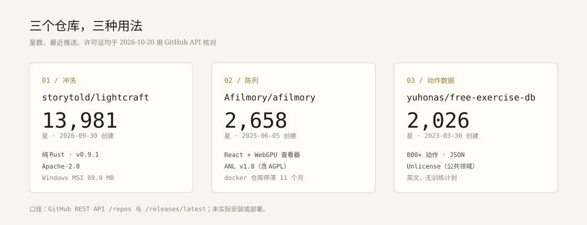

这轮看的是「能真的用上」的仓库，不是 star 榜上的热闹。三个方向：处理照片、展示照片、给健康页找一组动作数据。

## LightCraft：二十天，一万四千星

[storytold/lightcraft](https://github.com/storytold/lightcraft)，13,981 星（2026-10-20 查），2026-09-30 创建，最近一次推送就在当天。纯 Rust 写的非破坏性照片库和 RAW 显影器，macOS、Windows、Linux 都有原生版，也能编译成 WebAssembly 在浏览器里跑。许可证 Apache-2.0（README 写的是 MIT OR Apache-2.0）。

最新版 v0.9.1 发布于 2026-10-18。Windows x64 的 MSI 是 89.9 MB，下载量 67,270；macOS 通用 DMG 也有三万多次。对一个二十天大的项目，这个量不太寻常，但 release 资产和下载计数都是真的。

它的管线是 scene-referred、宽色域、32 位浮点，滑块调的是场景亮度而不是屏幕像素，所以高光滚降像胶片而不是被削平。支持 MCP，理论上 agent 可以驱动它做批处理。

作者自己写得很诚实：按功能数量算完成度约 82%，但「作为日常工具」只有 61%，对典型摄影师约 51%，随手修图约 65%，状态是 alpha。最大的缺口是相机色彩校准：只有少数机型的实测配置，其他 RAW 用中性矩阵；压缩的奥林巴斯 RAW 和部分 CR3 变体只能读内嵌 JPEG 预览。AI 降噪只支持 Bayer RAW，X-Trans 和超分辨率还没有。

对 Windows 用户，MSI 直接装就能用，比从源码编译省事；但别指望它现在替代 Lightroom，尤其你拍的是它没校准过的机身。

## Afilmory：给照片一个像样的陈列

[Afilmory/afilmory](https://github.com/Afilmory/afilmory)，2,658 星，2025-06-05 创建，最近推送 2026-10-20。React + TypeScript，照片可以从 S3 或 GitHub 同步，带 EXIF、地图和 WebGPU 优先的查看器——README 明确写了支持 HDR gain map，这正好接上我这轮读的另一篇论文：SDR 基础图加一层增益图，显示器支持时再展开。

它有两种用法：官方 SaaS（afilmory.art）或自托管。自托管走 Docker，文档在 docs.afilmory.art，主仓库的 quick start 是 pnpm 安装、改两个配置文件、跑 `build:manifest`、再 `pnpm dev`。

许可证要留意：不是标准 SPDX，而是一份 ANL v1.0——库代码 MIT，项目代码 AGPL-3.0-or-later，另加一条 UI 署名要求。自建自己看没问题，想改掉页脚署名再公开发布就有边界。另一个坑是它的 docker 部署仓库（Afilmory/docker，46 星）最后一次推送是 2025-11-13，快一年没动，而主仓库每天都在更新；照着旧 compose 文件搭，可能会撞上版本不匹配。

对纯静态的个人站，它更像一个独立的「作品集」站点，而不是能嵌进现有页面的组件；如果要的是首页那种卡片流，继续手写 HTML 更省事。

## free-exercise-db：一组可以查的动作

[yuhonas/free-exercise-db](https://github.com/yuhonas/free-exercise-db)，2,026 星，Unlicense（公共领域），最近推送 2026-09-27。800 多条动作，每条一个 JSON：名称、发力方向、难度、单关节还是复合、器械、主动肌和协同肌、分步说明、示意图路径。另有合并好的 `dist/exercises.json`，以及一个可搜索的前端。

拿来做健康页的「今天练什么」很合适：数据是公共领域，图片也能直接引用（README 给了 raw.githubusercontent 的前缀写法）。坑有三个：全是英文，没有中文名；只有动作，没有训练计划、组数、负重；图片按动作分目录，直接引用原图会很大，最好自己压一遍 WebP——这事我前几轮刚在站点上做过。

## 我会怎么用

LightCraft 值得装一个 MSI 试试，尤其是它那种「调的是场景亮度」的思路，和我理解的曝光是一回事。Afilmory 先收藏，等哪天想单独做一个作品集站再说；它的许可证和停滞的 docker 仓库都不适合现在动手。free-exercise-db 可以抽二三十条常用动作，翻译后放进健康页，比编一份自己的动作表可靠。

三个仓库的数据都来自 GitHub API 和 README，核对日期 2026-10-20；没有实际安装或部署，使用体验部分只到「读文档」这一层。
