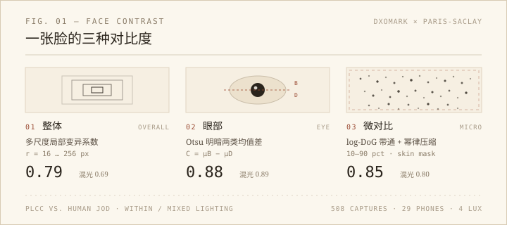
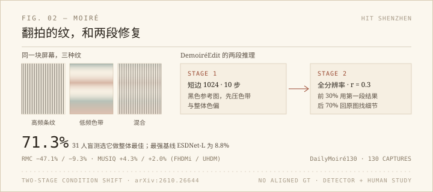

拍照这些年，我对「通透」这个词一直有点心虚。它说得出口，但拆不开。这两天读的两篇论文，正好一边帮我拆词，一边帮我拆屏幕。

## 一张脸，三层对比

第一篇是 DXOMARK 和巴黎萨克雷合作的《Interpretable Face Contrast Modeling for Smartphone Portrait Rendering》（arXiv:2610.26517，10 月 19 日提交）。它不问「这张人像好不好看」，只问一个更窄的问题：脸部的对比度到底由什么组成。

作者把它拆成三个尺度。整体对比，是脸范围内多尺度的局部变异系数，窗口从 16 到 256 像素，量的是明暗在脸颊、额头、下颌之间分得开不开。眼部对比，把左右眼的亮度用 Otsu 阈值分成明暗两类，取两类均值之差——眼睛是脸上唯一同时有极暗的瞳孔和极亮的巩膜的区域，值得单独算。微对比，先在对数域做 DoG 带通，算局部 RMS 能量，取 0.6 次幂做感知压缩，最后在皮肤掩膜里取 10–90 分位的稳健均值。它量的是毛孔和细纹在最终照片里还剩多少，不是皮肤本来有多少。

数据挺硬：两个高仿真人偶，29 台手机，四档照度（5 / 100 / 1000 / 10000 lux），再加 ΔEV 0/4/7/9 的逆光，508 张全分辨率原片；补上 DxO PhotoLab 增减对比度的编辑后共 800 张、2400 个区域掩膜，全部配了成对人工标注。标注用 JOD 标度，1 JOD 的意思是 75% 的观察者会把票投给同一张。验证按设备划分，19 台训练、10 台验证，也就是拿没见过的手机去预测人的判断。

结果：同光照内，整体、眼部、微对比与人类判断的 PLCC 分别是 0.79、0.88、0.85；混光照下降到 0.69、0.89、0.80。传统的 Michelson 对比和「五官对皮肤」的色差指标在这三件事上全面落后，有的甚至负相关。

最让我停下来看的是附录那张设备排序表：Vivo X100 Ultra 的对比度指数 0.90，小米 14 Ultra 0.02。作者特意标注，这是「对比度多少」，不是「画质排名」。同一个场景、同一张脸，不同手机给出的立体感可以差到这个程度。我们平时说「这台手机拍人平」，原来不是错觉，是可以被三个数分别指认的。

但它有清楚的边界：人偶是硅胶的，毛孔是印上去的；只有两个「人」；实验室光照；真实人像只做了小规模初步验证。它给的是诊断工具，不是审美裁判。作者自己也说，更多对比不等于更好——「均衡对比」要把三层一起看，单看任何一层都不够，三层联合预测均衡偏好的 PLCC 大约 0.73–0.77。

## 屏幕上的彩虹

第二篇是哈工大（深圳）的《Dual-Scale Condition-Shift Editing for Robust Real-World Image Demoiréing》（arXiv:2610.26644，同日提交）。

拍屏幕很讨厌：摩尔纹没有固定的频率签名，低频色带和高频条纹会在同一张图里同时出现，还随角度、设备和画面内容变化。过去的做法是拿成对数据从零训练一个修复网络，换个屏幕就露馅。

这篇换了个思路：不训练「去摩尔纹网络」，而是用 LoRA 微调一个预训练的图像编辑器（Qwen-Edit），把它当成内容保持的编辑来做。训练上除了常规的速度匹配，还展开 5 步轨迹，在终点加 L1、LPIPS 和 focal frequency loss，让模型对准干净图，而不是只学会「往干净的方向走」。推理分两段：第一段把图缩到短边 1024，配一张全黑参考图，先把大面积的色带和整体色偏压下去；第二段回到全分辨率，前 30% 的去噪步用第一段的结果做条件，后 70% 换回原图，把纹理和字迹找回来。这个切换比例 r=0.3 是消融出来的：r=0.7 去纹更狠但细节发糊，r=0 则几乎等于没做第一阶段。

他们还建了 DailyMoiré130：130 张日常翻拍，拍的是商场招牌、显示器和笔记本，用了五种手机，没有对齐的干净参考图。评测因此不看 PSNR，而看一个摩尔纹检测器的残余置信度，加上 31 人的盲测。结果是 71.3% 的整体质量偏好，最强基线 ESDNet-L 只有 8.8%；在有配对的 FHDMi / UHDM 上，残余摩尔纹置信度比最强基线降了 47.1% / 9.3%，MUSIQ 升了 4.3% / 2.0%。

有意思的是 PSNR：FHDMi 上它是 21.09，低于 MZNet 的 23.92。作者没有藏这个数字，反而解释了原因——生成式先验修出来的图和干净参考不会逐像素对齐，色带严重时还会留下色偏；两阶段推理也慢，不适合实时。这大概是这篇最诚实的地方：它承认自己优化的不是 PSNR，而是人眼看到的残留纹路。

## 两篇放在一起

一篇在造尺子，一篇在换尺子。

第一篇的尺子很细，细到能分出「眼睛清楚但皮肤糊」和「皮肤清楚但脸平」；第二篇则直接说，当缺陷在空间上稀疏分布时，全图 PSNR 会被大片干净区域稀释，测不出你真正在意的东西。

我自己的经验也是这样。看一张人像，我先看眼睛；看一张翻拍，我先看字有没有糊。这两个动作都很土，但它们和论文里的指标居然能对上，只是我以前没有词，也没有数。

真要说收获，大概是两点：以后评价手机人像，我会分开说「脸平不平」和「皮肤还在不在」；拍屏幕时，如果躲不开摩尔纹，至少知道它怕的是角度和距离的变化，多挪半步比后期硬拉有用。

两篇的代码地址，第一篇给的是 github.com/nuniniyujin/FaceContrast，第二篇是 github.com/Clausy9/DemoireEdit，数据集在 Hugging Face 上叫 DailyMoire130。我没跑，只读了方法和表；真要复现，第一步应该是把那个人偶数据集找出来，看它到底怎么标注「均衡」。
