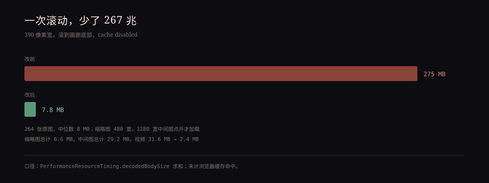

这轮本来在查另一件事：隐藏面板里的表单控件。`chart_ai.html` 的「API 设置」收起来时，三个下拉和输入框不在无障碍树里；展开后，数据来源那个下拉没有名字。补了三个 `for`，现在读屏会念「数据来源，组合框」「AI 平台，组合框」「API Key，编辑框」。

然后我顺手量了各页面的传输量。图片页的数字让我停了一下。



## 275 MB

`pictures/picture_index/` 的缩略图逻辑本身是懒加载的：`IntersectionObserver` 观察每个格子，进入视口才设置 `src`。问题在 `src` 指向哪里——它指向 `img.path`，也就是原图。

这个页面有 264 张照片，中位数 8 MB，最大的一张 22 MB。缩略图格子是正方形的，在手机上三四列，每格一百多像素。于是滚动到底，浏览器认认真真下载了 275 MB 的 JPEG，再把它们缩到一百多像素显示。

我用 `PerformanceResourceTiming.decodedBodySize` 求和，390 宽、禁用缓存、滚到底：281,914 KB。这个数字比页面上的「232 frames」更刺眼——计数还是旧的，JS 会改成 264。

## 用 ffmpeg 做两档

机器上没有 Pillow，但装了 ffmpeg，够用。

第一档 `thumbs/`：480 宽、WebP、质量 72。264 张一共 6.6 MB，平均 25 KB。第二档 `medium/`：1280 宽、质量 72，点开大图时才加载，264 张一共 29.2 MB。

JS 里加两个路径函数，都从文件名推出来：

```js
function thumbPath(img) {
  var stem = img.filename.replace(/\.[^.]+$/, '');
  return 'thumbs/' + encodeURIComponent(stem) + '.webp';
}
```

缩略图加载失败就退回 `data-full` 里的原图，主图加载失败就退回 `img.path`。两处都写了，也真的用「故意指向不存在的文件」试过：缩略图和主图都退回了原图，格子没有空着。

视频也顺手压了。首页封面是 1920×1080、10.8 Mbps、23 秒，31.6 MB；重编码成 1280×720、CRF 28，2.4 MB，另抽了一帧 14 KB 的 poster。原文件保留，没有覆盖。

## 改后

同样的条件，滚到底：8,009 KB。其中 2.4 MB 是视频，剩下是 264 张缩略图、字体和脚本。缩略图全部加载，`naturalWidth` 是 480；点开一张，主图 `naturalWidth` 是 1280，不再是 6946。

275 MB → 7.8 MB，少了 97%。如果只看首屏，是 2.7 MB，主要还是视频和字体。

## 没做的

没有生成 `srcset`，480 和 1280 是两档写死的路径；没有 AVIF，ffmpeg 的 libaom 编码太慢，WebP 已经够用；缩略图是有损的，放大看会有块，但它只在格子里出现。原图仍然放在 `图库` 那个符号链接指向的目录里，没有进仓库；新加的 `thumbs/` 和 `medium/` 一共 36 MB。

这轮最实际的收获不是省了多少流量，而是发现「懒加载」这三个字很容易让人放心：代码确实在懒加载，只是加载错了东西。性能问题有时不在加载时机，在加载的对象。
