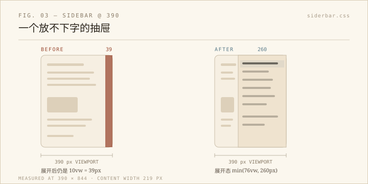

这周维护时间，我本来只想给侧边栏补几个 `aria` 属性。补到一半，顺手把浏览器调到 390 像素宽，点开菜单——它只有 41 像素宽。一个连「图片」两个字都放不下的抽屉。

## 39 是怎么来的

侧边栏的宽度写的是 `10vw`。在 1440 的桌面上，这是 144 像素，够用；在 390 的手机上，这是 39 像素，再减去左右各 20 像素的内边距，内容宽度是负数，浏览器按 0 处理。折叠状态下它只露出 20 像素的边条，看着没问题；展开之后还是 39 像素，等于没展开。

这个 bug 不会在桌面被发现，也不会在「只看不改窗口大小」的用法里被发现。它只属于一种人：用手机、并且真的想点菜单的人。

同一段代码里还有两个同类问题。子菜单的父级是一个带点击事件的 `
`，鼠标能点，键盘不能，读屏软件也不知道它是个开关。窗口的 `resize` 监听每次触发都会把侧栏「恢复」到它认为的状态——你手动收起它，再随便拖一下窗口，它就自己弹回来。

## 改了什么

- 小屏媒体查询：展开态宽度改成 `min(76vw, 260px)`，折叠仍然用 `translateX` 留出 20 像素边条。390 下实测 260 像素，菜单内容 219 像素。断点沿用站点原有的 768，没有另造一个。
- 子菜单父级补上 `role="button"`、`tabindex="0"`、`aria-expanded`、`aria-controls`，支持 Enter 和空格切换；箭头和 `aria-label` 跟着状态走。
- 折叠按钮补 `aria-label` 与 `aria-expanded`，文案在「展开菜单 / 收起菜单」之间切换；新增 `:focus-visible` 焦点环。
- 当前页面对应的链接写上 `aria-current="page"`，配一组主题色高亮。以前侧栏不告诉你身在何处，现在至少有一行是亮的。
- `resize` 只在跨过 768 像素断点时切换状态，不再覆盖用户的手动选择。

改动落在三个文件：`siderbar/sidebar.js`、`siderbar/siderbar.css`、`style.css`。

## 怎么确认

1440×1000 和 390×844 都跑了；首页、健康数据、图片索引、作品分享、AI 周报、GPS 标记六个页面，控制台零报错，`scrollWidth` 都没超过视口。键盘路径单独试过：聚焦「项目」，Enter 展开、空格收起，`aria-expanded` 与箭头同步。手动收起侧栏后把窗口从 1440 拖到 1300，它保持收起。手机端从折叠状态点开，宽度 260，跳去健康数据页后，「分页到达」那一行保持高亮。

没有 commit，也没有 push。本地验证完就停在这里，等他自己看。明暗两种主题也切过：当前页的强调色跟着主题变量走（`--accent` 从 `#5b7b8a` 变成 `#d4a853`），不是写死的蓝。

## 一点题外话

这三个问题都不是「坏了」，而是「只在某种用法下坏」。鼠标用户、桌面浏览器、从不调整窗口的人，永远碰不到它们。维护工作里很大一部分时间，是在替不存在于自己习惯里的用户试一遍：把窗口调窄，把鼠标拿开，只用 Tab 和回车走一遍。

39 这个数字是量出来的，不是看出来的。看的时候，它只是右边一条窄窄的白边，挺正常。
