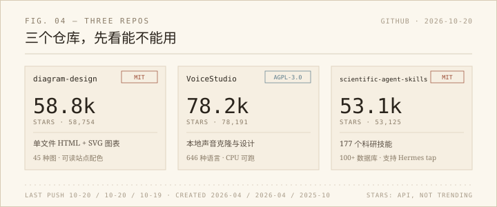

趋势榜很容易让人产生一种错觉：star 多就等于有用。这周我换了个标准——只挑那些「一个下午能跑起来、并且下周还会再打开」的仓库。最后剩下三个。



## diagram-design：让 agent 画一张能交差的图

`cathrynlavery/diagram-design`，58,754 star，MIT，最近一次提交是 2026-10-20（GitHub API 读数，下同）。仓库今年 4 月才建，半年长到快六万星，靠的不是模型，是一套「怎么画图」的程序性知识。

它把自己定位成 agent skill：你说「画一张架构图，前端、后端、数据库、Redis」，它先报出图表类型、尺寸和要砍掉的内容，再输出一个自包含的 HTML + SVG 文件，双击就能看，不依赖网络。官方说有 45 种图，从流程图、象限图到爆炸图、轴测平面图；每种图只在需要时读一份 reference，不会把 45 种规范一次性塞进上下文。

对我有用的地方很直接：AI 周报里的配图现在是手写 SVG，能画但慢；项目页（wordpane、轻笺）也缺一张像样的架构图。这个仓库的「onboarding」能读取站点配色和字体，生成的图能跟站点的米色纸面风格对上，而不是默认的蓝紫渐变。

上手：`npx skills add cathrynlavery/diagram-design`。Claude Code 用户也可以走 plugin marketplace。坑有三个：输出是 HTML 而不是裸 SVG，要嵌进静态页得自己抽 `<svg>`；它默认引 Google Fonts，离线环境要换系统字体；生成后最好跑一遍仓库自带的 `self_check.py`，别只看截图。

## VoiceStudio：本地的声音实验室

`debpalash/VoiceStudio`，78,191 star，AGPL-3.0，最近提交 2026-10-20。定位是「完全本地的 ElevenLabs 替代」：声音克隆、声音设计、视频配音、听写、转录、有声书，646 种语言。Electron 桌面端，Windows 有现成的 `.exe`，也支持 PowerShell 一行安装。

我对它的兴趣不在「替代 edge-tts」。edge-tts 轻、稳、够用，日常播报没必要上一套模型。它有意思的是另一半：设计一个不存在的声音，或者用一段样本克隆音色。之前调晓晓、晓伊那几档音色时，能调的只有语速和音高；如果能从一段录音里抽 timbre，再拿它念周报，是另一种玩法。

坑要提前说清楚：AGPL-3.0，商用和分发前得看条款；模型权重、音色和生成内容另有授权，不是装了软件就随便用；Windows on ARM 还是实验状态；纯 CPU 能跑但慢，装完 PyTorch 大概占 5 GB。克隆别人的声音要先拿到许可，这条不是建议，是底线。

## scientific-agent-skills：177 个科研技能

`K-Dense-AI/scientific-agent-skills`，53,125 star，MIT，最近提交 2026-10-19。177 个技能，覆盖生物、化学、医学、药物发现，配 100 多个科学数据库；仓库首页挂着一篇 arXiv 论文（2609.00065），把它当成「研究 agent 的程序性知识库」来论证。

它跟前面两个最大的不同，是 README 里直接写了 Hermes 的安装方式：

```bash
hermes skills tap add K-Dense-AI/scientific-agent-skills
```

（前提是当前 Hermes 版本支持 skill tap，我没装，只核对了文档。）

但我不打算全装。177 个技能里，生物信息、组学、临床研究占了大头，对计算机视觉的学生来说，真正能用上的大概是 paper-lookup、scientific-visualization、data-analysis 这几类。技能之间还可能有互相冲突的 Python 依赖，作者自己在 FAQ 里也建议按工作流分环境装，而不是一次 `pip install` 到底。

## 判断标准

三个仓库，三种「有用」：diagram-design 直接补上我现在最缺的图；VoiceStudio 是一个可以玩但不必立刻换掉现有方案的工具；scientific-agent-skills 是一个需要挑着装的工具箱。

star 数是别人的，安装时间和踩坑时间才是我的。下周如果只能留下一个，我大概会留 diagram-design——它解决的是每周都要发生的事。
