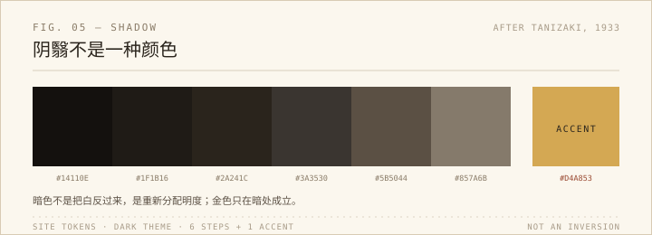

最近给站点调暗色，顺手重读了《阴翳礼赞》。这篇随笔 1933 年底到 1934 年初分两次发表在《经济往来》上，后来才收成单行本。谷崎写它的时候，电灯已经在日本铺开，他是在为一个正在消失的暗处说话。

他最有名的一句是：美不存在于物体之中，而存在于物与物产生的阴翳的波纹和明暗之中。例子都很具体：漆碗放在明亮的厨房里只是黑乎乎的一只，端进只有烛光的房间，金莳绘才浮出来；白米饭在暗处反而显得更白；银器用久了发黑，那层锈迹在西方人眼里是脏，在他说来是时间。还有那句常被引用的：夜明珠放在暗处才有光，宝石曝在阳光下反而失去魅力。他也写到能剧的衣裳：同样的颜色，在纸灯下和在日头下不是一回事。

我一边读一边想到暗色模式。大部分网站的「夜间模式」只是反相：白底变黑底，黑字变白字，对比度拉到最大，看起来干净，其实把阴翳赶走了。真正难的是层次——背景不是纯黑，是带一点暖的深褐；正文不是纯白，是偏黄的灰；强调色只在少数地方出现。站点现在这套 token 大概是这么分的：`#1a1714` 的侧栏底、`#e8e0d5` 的字、`#d4a853` 的金。金色在亮色主题里显得脏，在暗色里才成立，这大概就是谷崎说的「物与光之间」。

摄影也一样。数码把暗部提亮太容易了，HDR 一拉，阴影里的细节全出来，画面干净、正确，却没有空气。我想谷崎未必反对技术，他反对的是「把一切都照亮」的冲动。阴影不是信息的缺失，它有时候就是构图本身。

书里有一段写厕所，很多人第一次读会觉得古怪。他赞美的当然不是脏，是雨天、树影、木头的味道一起从走廊尽头进来的那种空间——一个功能性的房间也可以有诗意。这段让我想到摄影里的「环境」：同样的主体，换一个背景、换一束光，就成了另一张照片。我们花很多时间研究主体，却很少认真对待主体周围那圈暗。

但我不想把这篇随笔供起来。它的暗带着明显的时代和阶层前提：和室、烛台、能剧、漆器，都是有闲阶级的物件；他赞美的那种微暗，也包含今天看来并不浪漫的不便。读的时候要分开两件事：作为美学的「阴翳」，和作为生活条件的「没有灯」。前者可以借，后者不必怀念。

我读完最认同的倒不是「暗比亮美」，而是：阴翳不是黑暗本身，是黑暗里那一点微光衬出的东西。

所以现在看一套暗色主题，我只看一个很小的值：背景是不是纯黑。往上提一点，让它偏褐，屏幕上的黑就不那么绝对了。

