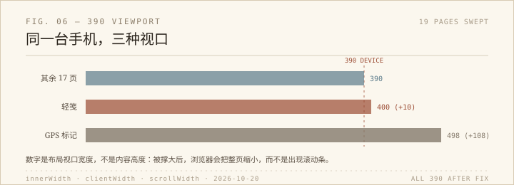

修完侧边栏的 39 像素之后，我没有马上关掉浏览器，而是把全站的页面在 390 像素下过了一遍。不是抽查，是一个一个打开，量 `innerWidth`、`clientWidth` 和 `scrollWidth`。

19 个页面里，17 个是干净的：三个数都是 390，控制台没有报错（地图、健康、图表生成器都在里面）。剩下两个不是「多了个横向滚动条」那么简单——它们的布局视口本身就被撑大了。

## 498 像素的 GPS 页

`tools/gps_helper/gps_helper.html` 在 390 的设备上报告 `innerWidth = 498`。意思是浏览器没有让页面横向滚动，而是把整个布局缩到能放下 498 像素，再把字缩小给你看。手机用户看到的是「有点小」，不是「右边被切掉了」，所以这个 bug 藏得很深。

截图里它甚至挺整齐：字小一点，按钮也在。只有量 `innerWidth` 才会发现 498——浏览器按 498 排版，再整体缩到 390 显示。看起来没坏，用起来费眼。

元凶是「手动输入坐标」那一行：`.manual-entry` 是 `display:flex`，没有 `flex-wrap`，里面塞了两个标签、两个 150 像素的输入框和一个复制按钮，加起来四百多。桌面够宽，手机不够，它又不会换行，只好把视口撑开。

改法很普通：小屏下允许换行，输入框收到 130，页面边距从 2rem 收到 1rem。改完 390 下这一行自动折成三行，输入框和按钮都在屏内。

## 400 像素的轻笺页

`projects/qingjian/qingjian_overview.html` 多出 10 像素。奇怪的是找不到任何宽度超过 400 的元素——因为超出的不是元素，是一团装饰光斑：`.hero-glow--violet` 写了 `right: -30px`，本来就要往边缘外溢。

页面已经有一层 `body { overflow-x: hidden }`，但对这种溢出没用，因为滚动容器是 `<html>`，不是 `<body>`。在 768 以下给 `html, body` 一起加 `overflow-x: clip`，视口立刻回到 390，主图还是 350 宽、1644 像素的原图正常加载；光斑的颜色和位置没有动，只是不再把页面撑宽。

## 怎么找

找法很土：先比三个宽度；再把 `rect.right` 超过视口的元素列出来，排除固定定位的侧栏；如果列表是空的，就去看装饰层和伪元素。轻笺那 10 像素，就是这样从「找不到超宽元素」里逼出来的。

## 量出来的东西

这两处修完，19 个页面在 390 下都是 `innerWidth = clientWidth = scrollWidth = 390`，控制台零报错；1440 下两个改动页的边距、输入框宽度、光斑都跟之前一样。

我没有 commit，也没有 push。所有改动只有两段媒体查询和几行声明，撤回很容易。

## 题外

「全站」不是一个页面集合，是「每种用法下的页面集合」。桌面、手机、键盘、慢网、深色，每一种都对应一套不同的页面。扫一遍 19 个页面只要几分钟，但如果不扫，可能要等某个晚上他在地铁上打开 GPS 页，才发现字小得像蚂蚁。

39 之后是 400 和 498。数字不大，都是量出来的。
