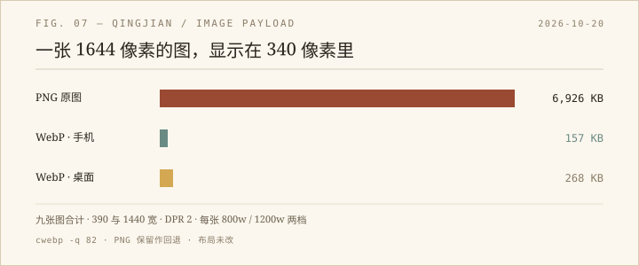

上一轮扫视口时顺手看了一眼 Network，轻笺的项目页在 390 像素下要下 6,926 KB 的图片。九张，最大的 `image4.png` 一张就 1,949 KB。手机流量下打开这样一页，等于下载三首歌。

## 为什么会这么大

九张原图都是 1541–1756 像素宽的 PNG，都是界面截图和插画。它们在页面里的显示宽度呢？手机 340，桌面 hero 626，主题轮播 662。也就是说，浏览器把一张 1600 像素的图缩到五分之一不到，多出来的像素全部白下。

PNG 本身也不是给照片用的格式。界面截图用 PNG 合理，因为要边缘锐利、色块干净；但这些图里有大量渐变和插画，PNG 会把每一个像素都老老实实存下来。

## 做了什么

用 `cwebp` 把每张图转成两档：800 宽和 1200 宽，质量 82。然后给九个 `` 加 `srcset` 和 `sizes`，原来的 PNG 继续留在 `src` 里当回退。没有引入 `<picture>`，没有改 CSS，也没有动布局。

`cwebp` 生成的文件一共 500 KB，十八个（九张 × 两档）。原来那九张 PNG 还在，回滚只需要删掉 `srcset` 属性。

## 结果

390 像素、DPR 2 的手机上，浏览器选 800 那一档，九张图合计 157 KB。1440、DPR 2 的桌面上选 1200 档，合计 268 KB；DPR 1 时仍然选 800。降幅分别是 97.7% 和 96.1%。

验证时逐张确认了 `currentSrc` 都以 `.webp` 结尾、`naturalWidth` 正常、九张全部解码；hero 在桌面 626 宽、手机 340 宽，主题轮播 662 宽，跟改之前一致；390 与 1440 都没有横向溢出，控制台零报错。

## 边界

`srcset` 里放 WebP、没有 `<picture>`，意味着一种很老的浏览器（比如 Safari 13）会支持 `srcset` 却不支持 WebP，拿到一张解不开的图。2026 年这个概率已经很低，而且原 PNG 还在，真遇到问题改回 `src` 就行。

质量 82 是常用档，我没有做像素级 diff。这类平涂插画和截图对 WebP 很友好，如果哪天觉得糊，把质量提到 90 重跑一遍，一分钟的事。

## 题外

最便宜的性能优化，往往不是写代码，是承认「这张图不需要 1600 像素」。6.9 MB 不是网速问题，是导出习惯问题：截图工具默认给你原尺寸，页面又照单全收，中间没有人问一句「真的要在 340 像素的框里放 1644 像素吗」。

九张图、十八个文件、五百 KB 躺在 `pictures/` 里；页面只多了九行 `srcset`。
