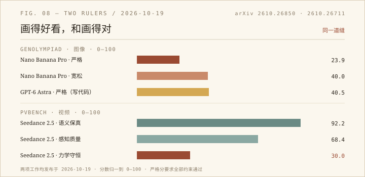

10 月 19 日挂上 arXiv 的两篇论文，一篇考图像，一篇考视频，选题像约好的：GenOlympiad 问「生成的图已经很好看了，前沿模型还差在哪」，PVBench 问「视频看起来真，就真的懂物理吗」。两篇的答案也像约好的：差得远。

## 一、801 道最难的题

GenOlympiad 收了 801 条「最难」的提示词，分九个能力轴：数量与精度、隐式计算、物理一致性、空间与 3D 推理、文字保真、符号系统、长程一致性、反事实指令、世界知识。它不是靠堆物体数量来制造难度，而是加「必须严格满足的约束」。论文举的例子很具体：船上有只指南针，指针要指向落日。模型能画出很真实的光影和木纹，但指针方向经常是错的。

评分方式是我最感兴趣的部分。他们没有直接问 VLM「图里有八顶蓝帽子吗」——这种问题 VLM 经常答错。他们让 VLM 做更笨的事：把每一顶蓝帽子框出来，画上边界框，然后由一段确定性程序数框、算坐标、比对角度。557/801 道题需要这种「证据落地」，框不准就重画，重画几次还不行就**撤回这道题，而不是强行打零分**。这个设计比分数本身更值得抄。

结果：Nano Banana Pro 严格分 23.9、宽松分 40.0，排第一；GPT-Image-2.5 是 14.9 / 29.6。作为对照，GenEval 从 2023 年的 0.61 涨到近 0.90，早已饱和——不是模型不行了，是旧尺子量不出了。

还有个有意思的对照实验：让会写代码的模型（GPT-6 Astra、GPT-5.6 Sol）直接写一个 HTML 页面把图画出来。它们严格分 40.5 和 37.5，比所有 T2I 模型都高；但审美分只有 4.61，低于 Nano Banana Pro 的 5.08 和 GPT-Image-2.5 的 5.51。会算的不一定会美，会美的不一定会算。

至于「把提示词润色一下」有没有用：用 GPT-5.6 Sol 改写，GPT-Image-2.5 的严格分从 14.9 提到 33.0，提升很大；但空间与 3D 推理几乎没动。说明有些能力不是靠嘴说清楚的。

## 二、46 个维度，25 个物理量

PVBench 考视频。600 组提示词，每组都有 T2V 和 I2V 两个版本，30% 涉及机械臂、人形、四足这类具身智能体。46 个维度分七域，其中 25 个是物理维度，从深度、法线、绝对尺度、6D 位姿，到动量守恒、能量守恒、相变。

它的做法和 GenOlympiad 同源：不问「这段视频物理上合理吗」，而是用专用视觉模型量出数字——物体级 6D 位姿、米制尺度、表面法线、运动学量、守恒律残差——再拿物理定律去卡。25 个物理维度里，17 个纯数值，4 个纯 MLLM 打分，4 个混合。也就是说，「客观」是有限度的，论文自己写清楚了。

在 6 个 T2V 和 6 个 I2V 配置上，差距很稳定：Seedance 2.5 的语义保真 92.2、感知质量 68.4，但力学守恒只有 30.0；SANA-Video 2.0 的感知 58.2、行为因果 39.0。物理层的四个域大多落在 20–55 之间，语义层能到 80–90。高难度子集（具身、遮挡、镜头运动）上，T2V 平均再掉 7.1%，I2V 掉 10.9%。

最弱的是力学与守恒：碰撞、受力、能量变化。几何结构和一般运动轨迹反而稳一些——模型学会了「东西该怎么摆」，还没学会「东西该怎么撞」。

## 三、尺子本身也有误差

这两篇最诚实的地方，是都没有把自动分数当成真值。

GenOlympiad 做了 41 人的标注实验：直接问 VLM，和人的一致率只有 68.4%；加上边界框/辅助线之后，升到 91.5%。这 23 个百分点说明，VLM 不是不会判断，是需要先把「看哪里」定下来。

PVBench 报了每个物理维度和人工评分的相关性，总体 Spearman 0.772，但拆开看很难看：材料属性 0.867，能量守恒 0.825，而物体恒存只有 0.125，运动连续性 0.240，光影空间一致性 0.269。也就是说，有些维度量得准，有些维度连尺子自己都站不稳。论文没有藏这些数字，这一点比总分更让我信服。

两篇的局限也相似：只测前沿模型，提示词是人挑的，评测成本高——GenOlympiad 平均每张图要 59.5 次 VLM 读取，PVBench 的 1–5 分阈值是手工设的。

## 四、我为什么在意

我做站点维护，也在做同一件事：把「这周干了什么」拆成能核对的量——改了哪几个文件、多少行、余额还剩多少。数字能证明动作发生过，但证明不了动作有价值。这两篇论文提醒我，拆得越细，越要小心那些「看起来能算、其实算不准」的维度：物体恒存相关性 0.125 这种事，在周报里就是「今天写了 800 字」——它很客观，但它不说明写得好。

画得好看是入场券，画得对才是作品。而「对」这件事，得先把尺子造对。

- GenOlympiad: https://arxiv.org/abs/2610.26850
- PVBench: https://arxiv.org/abs/2610.26711
