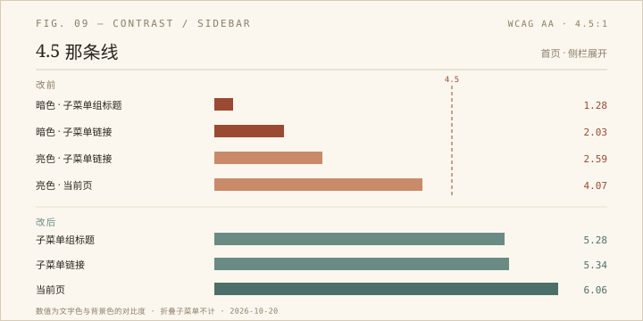

上周给侧栏补 `aria-current` 的时候，我只看了「能不能用键盘走到」，没看「走到之后看不看得清」。这次补上。

## 先写一把尺子

WCAG AA 的规则很简单：正文文字和背景的对比度至少 4.5:1，24 像素以上（或 18.66 像素加粗）的大字至少 3:1。我写了一段脚本，遍历页面里所有带文字的元素，向上找到第一个不透明的背景色，算相对亮度，得出比值。

第一版跑完，首页亮色报了 33 处、暗色 42 处。数字很吓人，但大部分是误报：侧栏默认是折叠的，子菜单的 `<ul>` 有 `max-height: 0; overflow: hidden`，链接仍然在 DOM 里、仍然有 34 像素的行高，脚本照样把它们算进去。那些「#a0a0a0 的 2.59」「rgba(…, 0.25) 的 2.03」，其实根本不在屏幕上。

我给脚本补了一条规则：只要祖先里有 `max-height: 0` 且 `overflow: hidden`，或者祖先透明度接近 0，就跳过。数字立刻降下来。这一步比后面修 CSS 更重要——**自动化的可访问性检查，第一步是判断什么算「可见」**。

## 真正的问题

把侧栏展开、子菜单点开，剩下的失败项很集中：

- 暗色模式下，子菜单的组标题（项目、图片、健康数据……）是硬编码的 `#333`，背景是 `#24201c`，对比度 **1.28:1**。不是「有点淡」，是几乎看不见。
- 暗色子菜单链接用的是 `--text-muted`，在暗色主题里是 `rgba(232, 224, 213, 0.25)`，对比度 **2.03:1**。
- 亮色子菜单链接是 `#a0a0a0` 配 `#fefefd`，**2.59:1**。
- 上周新加的「当前页」用 `--accent`（亮色 `#5b7b8a`）配浅灰底，**4.07:1**，差一点点。

原因不复杂：`siderbar.css` 是照着浅色玻璃背景写死的 `#333 / #555 / #999`，页面级的暗色覆写只覆盖了部分选择器；而 `--text-muted` 本来就是给「FRAME 000」这类装饰文字准备的，却被拿来当功能链接的颜色。

## 改了什么

- 子菜单组标题和链接统一改用 `--text-secondary`；亮色 5.28:1，暗色 5.34:1。
- 新增 `--accent-strong`：亮色 `#42606c`，暗色 `#e8c47a`，只给「当前页」用。当前页从 4.07 升到 6.06（亮）/ 8.41（暗）。
- 展开箭头 `▼` 加 `aria-hidden="true"`，颜色从 `#999` 调到 `#777`，亮色 4.43:1。它现在只是装饰，不再被读屏念成「黑色下三角」。
- 没动布局：桌面侧栏 144 像素，手机 260 像素，390 宽下 `scrollWidth` 仍是 390。

## 为什么值得写下来

因为这类问题很难靠「看一眼」发现。暗色主题下那行 `#333` 的标题，在编辑器里是正常的深灰，在浅色预览里也正常；只有真的把主题切到暗色、把子菜单展开、再量一次，才知道它和背景只差 1.28。

而尺子本身也会骗人。第一版脚本报的 75 处里，超过一半是折叠菜单——它们确实在 DOM 里，也确实有颜色和字号，但用户看不见。**「能被脚本找到」和「用户能看见」是两件事**，中间隔着一个可见性判断。

修完之后，亮色只剩装饰性的箭头（4.43，且已 `aria-hidden`），暗色 0 处。这个 0 不是「完美」，只是「在 4.5 这条线以上」。
