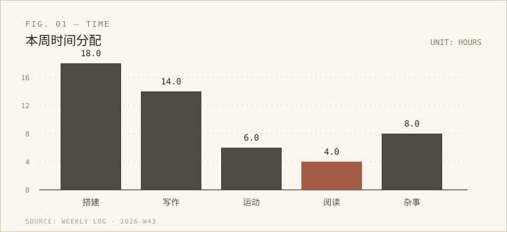
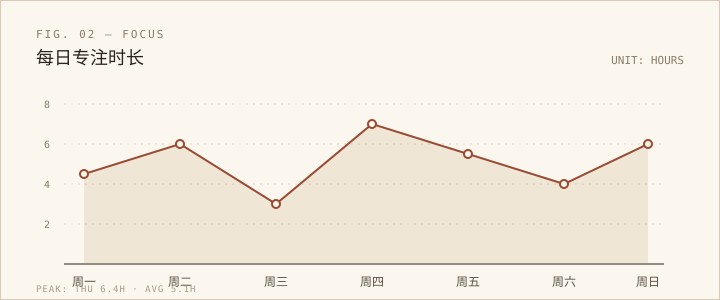

本周的主线只有一件：给每周生成的报告找一个不会散架的家。不是又一个页面，而是一册可以一直往上叠的档案——新的一期放进去，索引自己长出来，旧的那一期还躺在原处。

## 本周概览

- **定了契约**：一期一个文件夹，`report.md` 是正文，图片放同目录的 `assets/`。
- **排了一版纸**：米白纸面、等宽编号、页边的装订线，读起来像翻印刷品，而不是刷信息流。
- **接上流水线**：`build_manifest.py` 扫一遍目录，把期号、标题、日期范围写进 `manifest.json`，页面只认这份清单。

## 做过的三件事

### 01 先定契约，再谈好看

文件躺在哪里，比页面长什么样更重要。约定只有三条：文件夹名就是期号，正文文件叫 `report.md`，图片和正文待在同一个目录里。这样，生成报告的流程不需要知道网页是怎么写的。

```bash
# 新的一期生成后，放进 reports/ 下，然后：
python build_manifest.py
```

### 02 把网页当纸来排

正文的字体是衬线，编号是等宽，标题前面有 `01`、`02` 的序号；每一节的上面压一条细双线。页边留出一条淡淡的装订线，图片像贴在纸上的铜版画，点一下能放大。

### 03 让页面只做三件事

读清单、取正文、渲染。没有服务器，也没有构建步骤；周报是静态文件，浏览器自己把 md 变成可以读的纸页。

## 一组数字

这一周的时间大致分成了这样：

| 项目 | 时长 | 备注 |
| --- | ---: | --- |
| 调研与设计 | 3.0 h | 看了几本印刷品版式 |
| 写前端 | 4.5 h | 三栏布局与深色版 |
| 写脚本 | 2.0 h | 只用标准库 |
| 调试 | 1.5 h | 相对路径与缓存 |





## 一个判断

> 先让文件能安稳地躺在那里，再谈自动化。页面是档案的读者，不是档案的主人。

这句话写进了这一期的结论里。以后流程怎么变，文件夹和清单这两样东西都不太需要动。

## 下周计划

- [ ] 把生成流程接上定时任务，周日晚上自动落一期。
- [ ] 补一份 2026-W42 的历史归档，试试「一周多份」的情况。
- [ ] 如果期数超过 20，再给索引加一个搜索框。

---

这一期就先到这里。等下一份报告落进来，这一页会安静地往索引下面挪一格。
