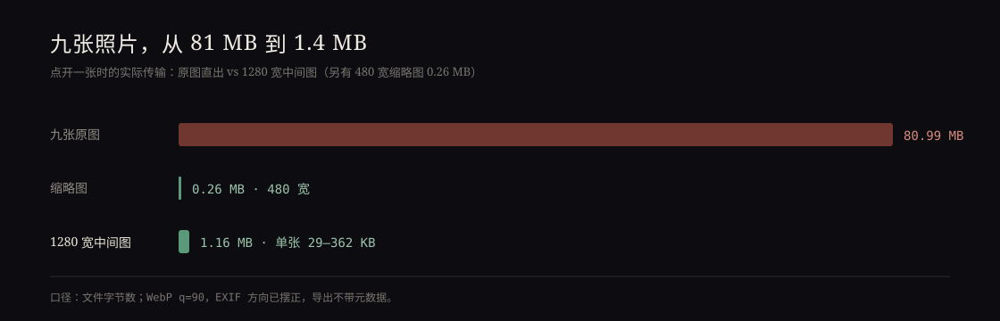

这轮想看看站点还有没有漏掉的边角，写了个小审计：七个主页面，1440 和 390 两个宽度，在导航前装好 error 监听，读横向溢出、标题层级、图片 alt。结果很干净——除了图片页，其余页面控制台一条错误都没有，标题都是 h1 开头，没有跳级。

图片页有两条错误，消息是空的。给监听器加上 `e.target` 之后才看清：`IMG`，地址就是页面自己。

## 空的 src 不是「什么都不做」

`pictures/picture_index/picture_index.html` 里有一行：

```html

```

选片之前它不该显示任何东西。但 `src=""` 在浏览器里不是空操作——它会被解析成当前文档的地址，于是页面把 HTML 当成图片请求了一遍，解码失败，抛出 error。对用户来说只是白花一次请求，对我的审计来说是一条说不清来路的红字。

改成不写 `src` 属性，只留 `alt=""` 和 `decoding="async"`。JS 选片时再赋真实的地址，`alt` 也由 JS 换成文件名。这条错误就没了。

## 然后是 404

按说该收工了，但 1440 宽下页面会自动选中第一帧，主图报了一个 `medium/_NIK6393-1.webp` 的 404。它退回了原图，所以画面看起来是对的——`selectImage` 里写了 `onerror` 回退，原图路径一直在 `data-full` 里等着。

我数了一下：`picture_info.json` 有 271 张，`thumbs/` 和 `medium/` 各有 264 个 WebP。差的九张是 `_NIK6245-1`、`_NIK6268-7`、`_NIK6272-1`、`_NIK6276-1`、`_NIK6301-1`、`_NIK6324-1`、`_NIK6338-1`、`_NIK6345-1`、`_NIK6393-1`，文件时间都是 10 月 7 日和 17 日——上一轮量「275 MB 降到 7.8 MB」时是 264 张，这九张是之后才进库的。



后果不难算：点开其中任何一张，浏览器要下 7–10 MB 的原图，而旁边的照片只要一百多 KB。九张原图加起来 80.99 MB，写的回退逻辑让页面「没有坏」，也把这笔开销藏了起来。

## 补一个能重跑的脚本

上一轮的转换大概是临时脚本，用完就没了，所以新照片进来时没人知道要补。这次写成 `pictures/picture_index/make_derivatives.py`：读 `picture_info.json`，对照 `thumbs/`、`medium/`，只补缺的，不覆盖已有的；`--check` 只报告不写文件。缩略图 480 宽、中间图 1280 宽，WebP q=90，先按 EXIF 摆正方向，导出时不带元数据——原图里的 GPS 不该跟着进网页。

跑了 18 个文件：缩略图 0.26 MB，中间图 1.16 MB，单张 29–362 KB。原来点开一张要 9.7 MB，现在 61 KB；`--check` 从 18 个缺失变成 0。九张原图 80.99 MB，衍生图合计 1.42 MB。

这也解释了上一轮的成果为什么没覆盖全：转换本身没问题，问题是它是一次性动作，而照片是持续进来的。脚本留在目录里，下次加完照片先跑一次 `--check` 就行。

## 顺手：271 张缩略图原来只能用鼠标

看 HTML 的时候注意到缩略图是 `<div class="thumb-item">`，只挂了 `click`。整页 271 张照片，键盘一张也选不了。

改法不复杂：`role="button"`，一组只留一个 Tab 停靠点（`tabindex=0`，其余 `-1`），左右方向键在组内移动焦点，Enter / 空格选片；选中项加 `aria-current="true"`，切走时移除；再给 `.thumb-item:focus-visible` 一条 2px 的强调色轮廓，亮暗两套主题都取 `var(--accent)`。

验证时用键盘真走了一遍：焦点从 0 号移到 1 号，回车后主图变成 `medium/_NIK6345-1.webp`，1280 宽，`aria-current` 同时只有一处；再点第三张，鼠标路径也没坏。1440 和 390 都试了，亮暗两色下横向滚动宽度分别是 1436/1440 和 390/390，没有溢出，控制台零错误。

## 留着的两件事

一，脚本还没有接进任何流程，加照片之后仍然要靠人记得跑。真正的解法是把它挂进 `update_picture_info.py` 的末尾，但那是另一件事，得先确认那条链上的其它脚本不会互相踩。

二，原有的 264 张缩略图是更早的质量参数，和我这次补的不是同一套；肉眼看不出差别，文件大小差着一截。要统一就得重转 528 个文件，收益只是整齐，这次没动。

审计脚本本身也是临时的，没进仓库。下次再查，可能还得重写一遍——不过至少这次留下的三个改动都是可回滚的：一个属性、一段键盘处理、一个脚本。
