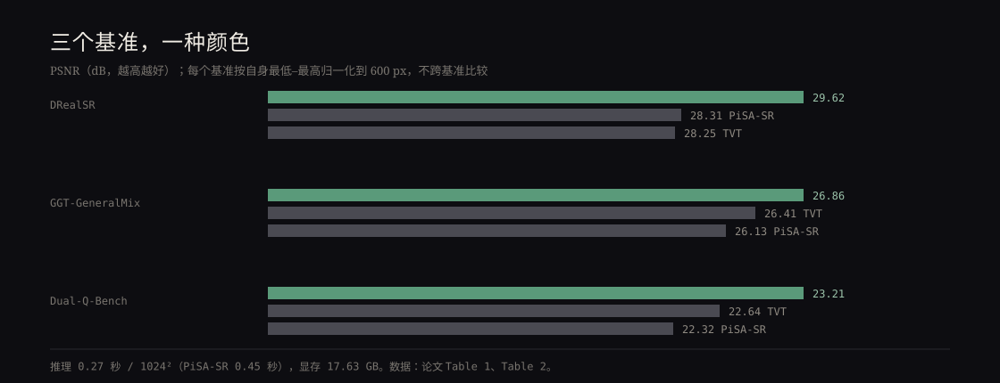

我对「把旧照片放大」这件事一直有点警惕。手机相册里那些 2013 年的照片，放大两倍之后人脸是清楚的，但清楚得不像本人——模型把细节「补」了出来，补的是它见过的平均脸。这篇 10 月 26 日的 HiFiPix（arXiv:2610.35515，北邮 + vivo BlueImage Lab + 浙大）想解决的就是这个老问题：既要清楚，又要真的是原来那张照片。

## 细节是在哪一步丢的

现在主流的真实场景超分（Real-ISR）大多建在潜空间扩散模型上：先把低质图送进 VAE 编码器压成潜变量，去噪，再解码回像素。问题就出在这个「压」字——VAE 的压缩是不可逆的，细小的纹理在这一步就没了，后面再强的生成模型也只能猜。论文里举的例子是树叶糊成一片、招牌上的字变形。

另一条路是像素空间扩散：不压，直接在像素上做。但把预训练的像素级模型（他们用的是 HiDream-O1-Image）拿来微调，会冒出两个新问题：

1. **网格接缝。** 像素模型按 patch 切 token，patch 之间只在注意力块里交换信息，没有 VAE 解码器那种卷积带来的空间连续性。于是边界处出现周期性的高频伪影，输入越糊越明显。论文有一个观察挺关键：这不只是结构问题，而是「高频没重建好」——所以他们在频域上动手。
2. **生成力衰退。** 去掉 VAE 也去掉了紧凑的语义表示，模型更容易滑向「保守地重建」，细节是稳了，但该补的地方补不出来。

## 三个补丁

**CSWD（跨尺度小波判别器）**：冻结的 DINOv3-ConvNeXt 抽多级特征，每级做小波变换，丢掉低频 LL，只留 LH/HL/HH 三个高频子带拼起来，再把浅层高频注入下一级。判别器在三个尺度上出逐像素的 logit，专门惩罚那些周期性的边界伪影。

**MixCSD（Mixup 对比自蒸馏）**：同一个 LoRA 权重跑两条分支，一条吃纯低质图，一条吃「真值 + 低质」的混合图（混合比例 α），后者停梯度，当作正样本；在 DiT 的中间层用 InfoNCE 把每个 patch token 往它的混合版本拉、推远其它 patch。等于告诉模型：边界应该长成什么样。

**LoRA-SP（选择性剪枝）**：他们逐层拆 LoRA 做消融，发现各层的角色并不均匀——有的层只是在重复浅层已经做过的变换，剪掉反而释放生成力；有的层一动，保真度就塌。于是用 CKA 算每层表示相对浅层的漂移，漂移不再下降的层进候选，再留一个「保真关键层」白名单，按预算逐步冻结。

## 数字

在 DRealSR 上 PSNR 29.62（PiSA-SR 28.31、TVT 28.25），GGT-GeneralMix 26.86（TVT 26.41），他们自建的 Dual-Q-Bench 23.21（TVT 22.64）。感知指标不是全胜：DRealSR 的 LPIPS 是 0.2898，ODTSR 更低（0.2591）；DISTS 也是 ODTSR 更好。论文的说法是「保真度与感知质量同时领先」，更准确的说法是 PSNR/SSIM 领先明显，感知指标在多数基准上领先、个别不如专门做感知的模型。

成本方面：1024² 单张推理 0.27 秒（PiSA-SR 0.45 秒），但显存 17.63 GB，是 PiSA-SR（6.89 GB）的两倍多。换句话说，它换来的是速度，不是轻量。

自建的 Dual-Q-Bench 值得单说。作者认为现有基准的真值本身就不够好：RealSR/DRealSR 的真值有模糊和背景虚焦，生成模型补出来的细节反而比真值清楚，于是参考指标会惩罚「更好的结果」。他们的做法是挑 100 张 1024² 的高质量照片当 GT，再把照片显示在 4K 屏上、用手机拍下来当低质输入——真降质、真对齐（SIFT + RANSAC + ECC 精修）。17 人偏好测试里，76% 选它，第二名 GGT 只有 10.7%。这是很有说服力的数字，但 17 个人、100 对图，样本不大；拍照用的手机型号要等论文接收才公布，复现性打了折扣。

## 两个诚实的消融

CSWD 和 MixCSD 单独用，都会拉高保真、压低生成：基线 PSNR 25.53 / MUSIQ 70.67；只加 CSWD 是 25.83 / 68.62；只加 MixCSD 是 25.77 / 68.88；两个都加是 26.12 / 69.86。合起来才把两边都拉回来一点，但仍然没有回到基线的 MUSIQ。

LoRA-SP 更微妙：随机剪枝直接崩（PSNR 25.27），只做冗余检测会把生成力抬到 71.17、但保真掉到 25.81；加上保真白名单后是 26.06 / 70.92——用 0.06 dB 换 1 个 MUSIQ 点。作者还试了把这套用在 VAE 模型 Z-Image 上，PSNR 反而从 23.81 掉到 23.05，说明它只对像素空间模型有意义。

## 我的判断

这篇最值得记的不是 29.62，而是它把「接缝」重新定义成了「高频重建失败」。同一个现象，从结构问题换成频域问题之后，解法就从改架构变成了加一个判别器——这种换视角比堆模块更有意思。

另外是那个基准问题。我们做图像的人都知道「真值不一定真」：我那批水印照片，导出时的锐化就是参考，任何模型补出来的细节都会被它判成错。HiFiPix 干脆自己造一套更干净的真值，这个方向我认同，但它也意味着以后比较不同论文时，得先看它们用的是谁的真值。

限制也清楚：论文还在 under review，代码和模型说会放但还没放；极度模糊的输入仍有残留接缝；不用文本提示，所以没测 CLIPIQA 这类文本相关指标。0.27 秒听起来能上手机，17.6 GB 显存说明它现在只属于工作站。
