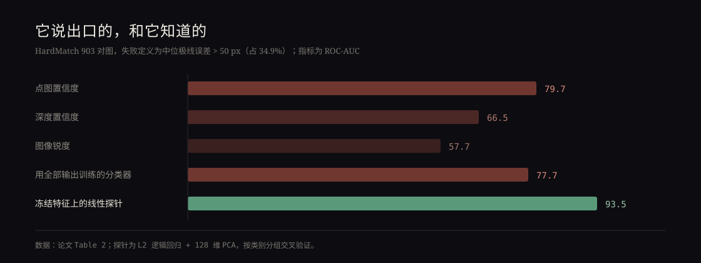

VGGT 是这两年被用得最多的一类前馈三维重建模型：给它两张（或更多）照片，一次前向就吐出相机内外参、深度图和点图，把传统 SfM 里最麻烦的那一整套匹配、求解、优化压进了一个网络。它对外提供逐像素的置信度，用来告诉下游「这个点别太信」，但对它回归出来的相机位姿，什么不确定性都不给。于是一个摆错了几十度的相对位姿，和一个摆得不错的相对位姿，在输出上看不出区别。

昨天挂出来的这篇《Does VGGT Know What It Does Not Know?》就在问：模型自己知不知道它错了。

## 先看它错得有多频繁

作者用 HardMatch，一个专门收集「难配对」的基准：一千对人工标注了对应点的图片，涵盖航拍对地面、大幅视角变化、照片对素描、季节与光照变化。过滤掉动态场景和对应点太少的对子之后，剩下 903 对，97 个类别。用 VGGT 自己预测的相机推基本矩阵，再算极线误差，中位数超过 50 像素（约图像宽度的 5%）就算失败——**34.9%** 的对子失败。阈值收到 10 像素是 63.7%，放到 100 像素仍有 25.1%。

然后是最关键的一步：把 VGGT 冻住，取它中间层的特征，池化、PCA 降到 128 维，训练一个带 L2 的逻辑回归。交叉验证按类别分组，保证测试类别在训练时一次都没出现过。

93.5% 的 ROC-AUC。相比之下，它自己输出的点图置信度是 79.7%，把 VGGT 的全部输出（两套外参、焦距、各种置信度统计）喂给一个分类器，也只有 77.7%。换句话说，**探针并没有在重读输出，它读到的是输出里没有的东西**。阈值取 0.5 时，探针判对 87.5% 的对子，抓住 87.6% 的失败，精确率 78.9%；把置信度调到标出差不多数量的对子，只有 74.0% 的准确率、68.3% 的召回和 61.4% 的精确率。

我更在意的是「自信地错」这一类。按点图置信度把对子分成四档，失败率从最低档的 64% 掉到最高档的 6%——看上去置信度很有用。但**在每一档内部**，置信度排失败的能力接近抛硬币（AUC 47%、61%、64%、57%），探针则是 90%、91%、92%、82%。在最自信的那一半里，仍然有 12.2% 的对子失败，探针 90.0%，置信度 69.9%。

## 这个信号是在哪一层长出来的

作者把网络每一块都探了一遍。每张图独立过的那段 ViT 编码器，从头到尾不超过 65.2%（第 6、12、23 块分别是 59.3%、64.6%、65.0%）——一对图难不难，单看哪一张都看不出来，这倒不意外。

意外的是融合段的前半截：这里已经在做帧间和全局的交替注意力了，但一直到第 10 块，探针都停在 63%–66%。然后第 11 块 69%，第 12 块 81%，第 13 块 88%，第 15 块 93%，峰值 94.0% 在第 18 块。**它不是随着两张图相遇慢慢积累出来的，而是在很窄的一段里突然出现。**

还有一条不用训练的读法：两张图池化特征的余弦相似度，在前 15 块都停在 61%–69%，到最后一层升到 83.7%——位姿错的时候，模型对两张图的表示干脆不再互相认同。但这个读法到了相机 token 又掉回 71.0%（同一位置训练过的探针仍有 93.2%）：信息还在，只是不再以「两张图不一致」这种朴素形式存在。

第二个模型 π³ 上结论一样：失败率 34.6%，自己的置信度只有 62.2%，探针 91.7%；在最自信的一半（仍有 27.3% 失败）上，置信度 52.8% 等于瞎猜，探针 92.7%。但 π³ 里那条免训练的余弦从头到尾没升起来（≤69%）。所以「两张图不再认同」是 VGGT 特有的读法，而「失败可线性读出」是两个模型共有的。

## 换个数据集还灵吗

PhotoTourism：1,262 对地标照片，位姿来自大尺度 SfM，失败按旋转误差定义。VGGT 在这里很少错，超过 15° 的只有 1.7%，而且几乎全挤在共视极低的对子上。HardMatch 上训出来的探针一个 PhotoTourism 样本都没见过，直接搬过去：10° 阈值 94.6%，15° 阈值 97.5%，5° 阈值 87.1%，每个阈值都高于置信度（88.5%、90.6%、79.2%），和专门在 PhotoTourism 上训练的探针差不多。它和旋转误差大小的秩相关是 0.43，置信度是 0.33。

这会不会只是「共视低」的另一种说法？作者做了三重排除：真实共视度本身（部署时拿不到）预测失败反而不如探针（87.0%、89.8%）；只在共视最低的那批对子里比，探针仍有 86.9%、89.5%，置信度 79%，共视度 74%–76%；把共视度回归掉之后，探针与误差的秩相关还有 0.23，是置信度（0.11）的两倍。

## 边界在哪里

到 ScanNet-1500，故事断了。室内的旋转其实很准（中位误差 1.2°，超过 5° 的只有 2.1%），115 对位姿失败里有 113 对旋转误差小于 5°——错的是平移方向。而且集中在短基线上：两台相机相距不到 10 厘米时，47% 的对子平移方向错超过 15°；超过 40 厘米就不到 1%。HardMatch 探针在这类失败上只有 44%–48%，等于没用；但拿 ScanNet 自己的数据训一个探针，能到 90.5%–91.0%。也就是说特征里确实编码了这种失败，只是方向和 HardMatch 学到的不是同一条。

所以「模型的自我认知」不是一个标量。一个线性读出能跨数据集迁移，管的是朝向；病态的短基线平移，需要另一个读出。

## 三个负结果

多视角会把这些失败抹掉。同一批 2,304 对图，分别放在 2、4、8、16 视角的前向里跑，旋转误差超过 5° 的比例从 3.6% 降到 1.4%、0.5%、0.3%，8 视角以上一对都没超过 10°。剩下那点失败，探针和置信度谁也没明显更好。

拿它去筛边、改善旋转平均，也没有收益。鲁棒平均已经把平均绝对旋转误差从 1.27° 压到 0.70°；按探针丢掉最不可信的 10% 边是 0.66°，按置信度丢是 0.67°，而一个知道真实误差的 oracle 也只有 0.67°。失败边不到 2% 时，鲁棒估计自己就吸收了。

把难对子路由给专门的匹配器 LoMa 也不行：LoMa 在 HardMatch 测试集上 mAA@10 是 50.8%，VGGT 只有 19.9%，两者几乎不互补——一个总能挑对的那个 oracle 也只有 52.1%，学出来的路由器 51.1%。

## 我的判断

这篇最值得记的不是 93.5% 这个数字，而是它解释了一个很常见的误会：**模型给出的「置信度」，回答的是它被训练去回答的那个问题**。VGGT 的逐像素置信度是在不确定性加权损失里学出来的，它描述的是「这个深度/点好不好回归」，不是「两台相机摆得一致不一致」。而融合层的特征正是相机头回归位姿时所读的那份表示，两张图对不齐的证据留在那里，相机头把它压成了一个位姿，证据就没了。

工程上这很实用：一个线性层，加在模型本来就要算的特征上，就能给下游一个「要不要换一张图、要不要退回复核」的信号，成本几乎为零。但它也有很清楚的天花板——探针是有监督的（需要失败标签），置信度是免费的；只验证了两个模型；只做了两视图；失败标签来自每对约 11 个手工对应点，本身混着旋转、平移和内参的误差。论文自己也把这些列在 Limitations 里。

我喜欢的部分是那个时间结构：知识在第 12 到 15 块之间突然出现，然后被后面的头丢掉。不是「模型不知道」，是「知道了，但没往外说」。

论文：Adityan Thirumani Srinivasan, David Nordström, *Does VGGT Know What It Does Not Know?*, arXiv:2610.35806, 2026-10-26。代码作者说会公开。
